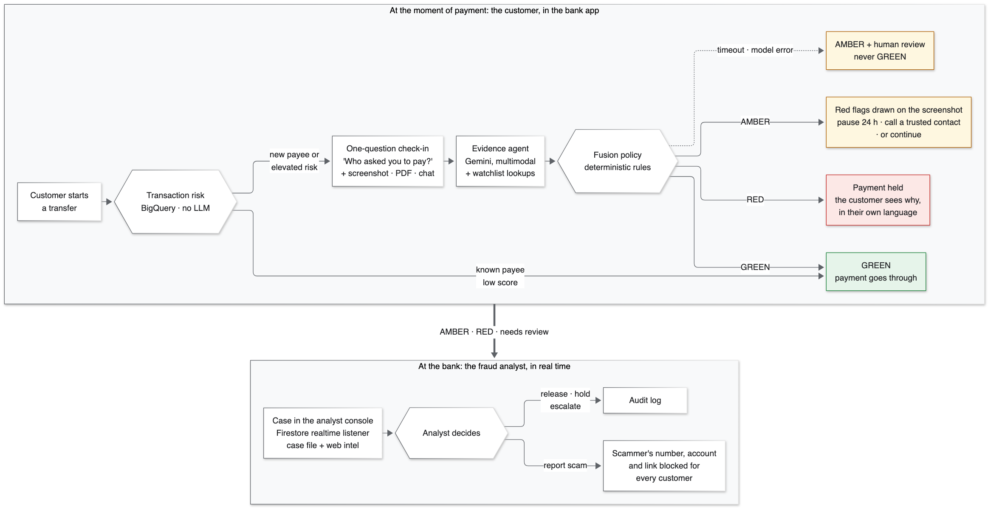
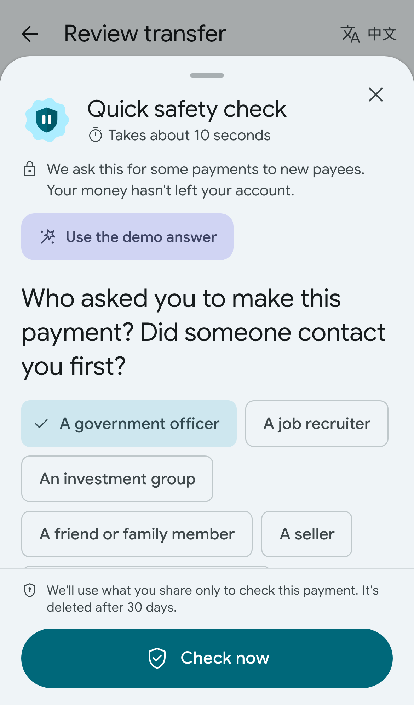
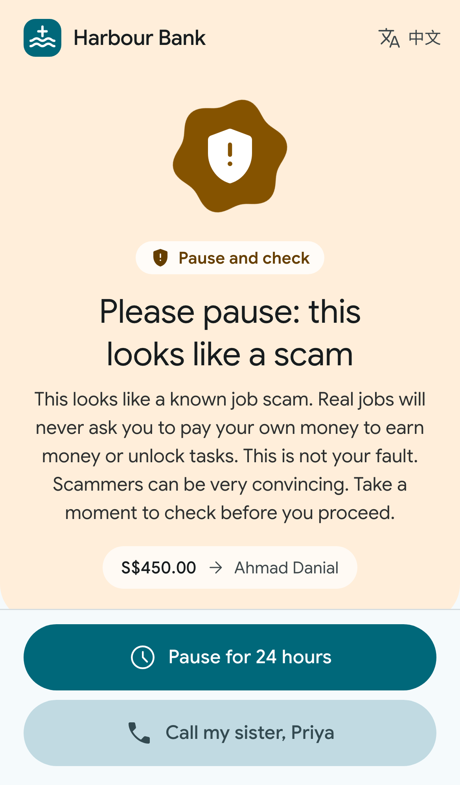
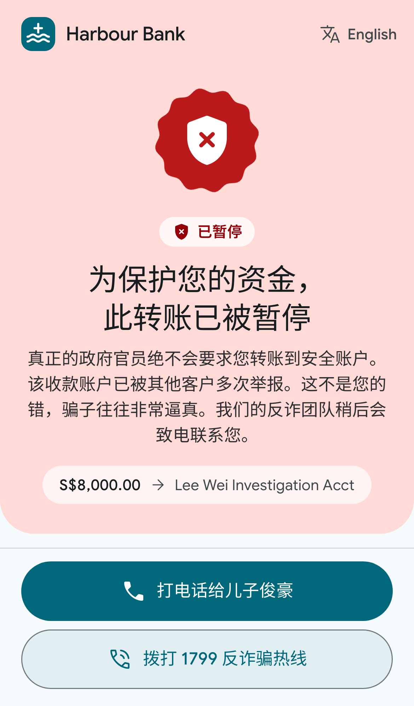
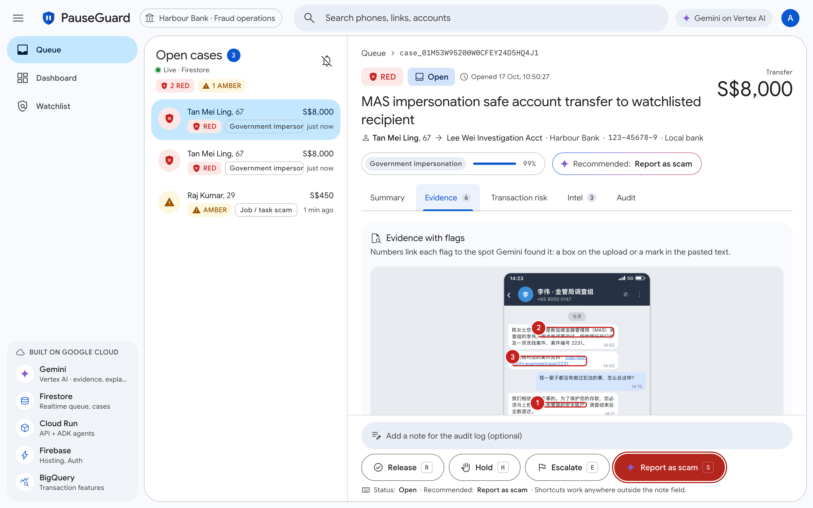
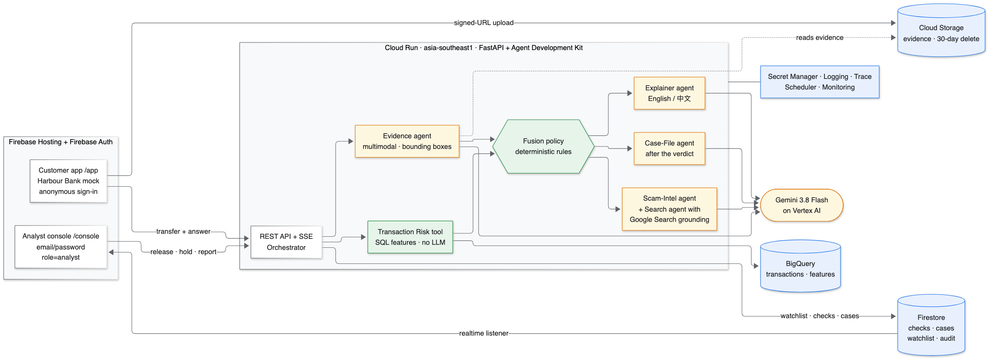
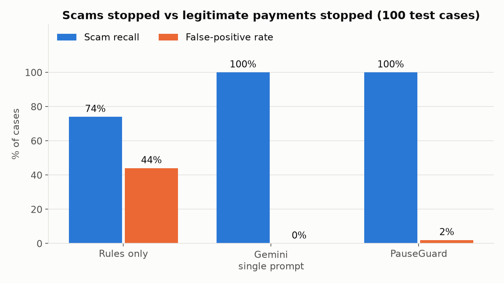

# PauseGuard

**Fraud models check the transaction. PauseGuard checks the conversation.**

PauseGuard is an AI copilot that stops authorised-push-payment scams at the moment a bank customer is about to send money. When a transfer looks risky, the bank app asks one quick question, *"Who asked you to make this payment?"*, and lets the customer share the WhatsApp chat, SMS or screenshot behind it. Gemini agents built with Google's Agent Development Kit read that evidence, check it against a shared scam watchlist, and a plain, auditable rule set decides whether to let the payment go (GREEN), pause it and explain the red flags (AMBER), or hold it for a bank analyst (RED). The customer sees exactly why, with numbered boxes drawn on their own screenshot, in their own language, and the analyst gets a ready-made case file in real time.

Built for the **Google Cloud AI Builder Cup 2026** (BFSI theme) by team **Cikoh**. Everything runs on Google Cloud: Firebase, Firestore, Cloud Run, Gemini on Vertex AI, BigQuery and more.


*The live app, recorded with Playwright against the deployed stack (real Gemini calls; played at 1.5×).*

## Try it live

| What | Link |
|---|---|
| Landing page | **https://pauseguard-sg.web.app** |
| Customer app (Harbour Bank mock) | https://pauseguard-sg.web.app/app — pick a persona, no sign-up |
| Analyst console | https://pauseguard-sg.web.app/console — the demo login is prefilled |
| API docs (OpenAPI) | https://pauseguard-api-952883120789.asia-southeast1.run.app/docs |

**Demo logins**
- **Customers:** choose Mrs Tan, Raj or Aisyah on the persona picker (Firebase anonymous sign-in happens in the background). In the transfer form, **Prefill demo scenario** fills in their payment, and in the check-in, **Use the demo answer** attaches their evidence.
- **Analyst:** `analyst@harbourbank.example` / `HarbourDemo2026` (prefilled on the console's sign-in page).

| Persona | Scenario | Expected result |
|---|---|---|
| **Mrs Tan**, 67, reads Chinese | S$8,000 to a new payee; a fake "MAS officer" on WhatsApp told her to move her savings to a "safe account" | **RED**: payment held, red flags boxed on her screenshot, explanation in Chinese, "call my son" and the 1799 anti-scam helpline |
| **Raj**, 29 | S$450 "top-up" to unlock a job commission (Telegram chat) | **AMBER**: "paying to earn is a known job scam"; pause 24 h or continue after confirming |
| **Aisyah**, 34 | S$3,200 deposit to her new landlord, tenancy agreement PDF attached | **GREEN**: goes through in one step |

All data is **synthetic**: Harbour Bank, the customers, payees, phone numbers and chats are fictional. The API scales to zero between visits, so the first request after a quiet spell can take ~8 s (the landing page wakes it in the background). Demo data resets every 6 hours.

## The problem

Singapore lost **S$913.1 million to scams in 2025** across 41,974 cases, and in **81.8% of cases the victim made the transfer themselves** (median loss S$1,644; [Singapore Police Force, Feb 2026](https://www.police.gov.sg/media-hub/police-life/2026/02/scams-and-cybercrime-fell-by-almost-a-quarter-in-2025)). The device, password and OTP are all genuine, so to the bank's fraud system the payment looks normal. The evidence of the scam is in the conversation that persuaded the customer, and the bank never sees it. Generic "beware of scams" pop-ups don't break a scammer's spell; a specific, personal explanation can.

## How it works



1. **Transaction risk** (BigQuery, no LLM, ~1 s): new payee, amount versus the customer's 90-day median, velocity, destination type, time of day. A known payee with a low score goes straight through.
2. **Check-in:** one templated question with quick-reply chips, plus an optional screenshot, PDF or pasted chat (signed-URL upload to Cloud Storage).
3. **Analysis, in parallel:** the Evidence agent (Gemini, multimodal) extracts scam typology, red flags with **bounding boxes** and entities (phones, accounts, links), while the payee and those entities are looked up in the Firestore watchlist.
4. **Fusion policy** (plain Python, 100% branch-tested) decides GREEN / AMBER / RED. The LLM never decides.
5. **Explainer agent** writes the customer message in English or Chinese, from the structured flags only (it never sees the raw, possibly hostile, evidence).
6. **For AMBER/RED**, a case appears in the analyst console through a Firestore realtime listener; then the Case-File agent and the Scam-Intel agent (Google Search grounding) enrich it in the background. An analyst can release, hold, escalate or **report the scam**, which adds the scammer's number, account and link to the watchlist for every customer.

If a model call fails or runs past the 12 s budget, the answer is **AMBER + human review, never GREEN**.

| Check-in | AMBER: Raj | RED: Mrs Tan (Chinese) | Analyst console |
|---|---|---|---|
|  |  |  |  |

## Design

Everything is built on **Material 3**, in two colour schemes that share one set of tokens, so each component is written once ([`docs/UI_SPEC.md`](docs/UI_SPEC.md)):
- **Customer app (Harbour Bank):** a Material You scheme generated from the bank's harbour-teal colour, in a Pixel-style phone frame, with a bottom sheet for the check-in. Each verdict has its own icon, word **and shape** (M3 Expressive shapes), so it never relies on colour alone. A morphing loading indicator runs during the check.
- **Analyst console and landing page:** Google's own Material 3 look, as in the Cloud console and Workspace: navigation drawer, a search bar that looks up phones, links and accounts in the watchlist, KPI scorecards and data tables. Text written by Gemini (the case summary and recommended action) is labelled **"Written by Gemini"**; the verdict's reasons are labelled **"Rules, not AI"**.
- Google Sans and Noto Sans SC, Material Symbols icons, WCAG 2.1 AA contrast, keyboard shortcuts in the console, and axe checks on every customer screen on desktop and phone (`make a11y`).

## Architecture



### Google Cloud services used, and why

| Service | What PauseGuard uses it for | Why this service |
|---|---|---|
| **Gemini 3.8 Flash on Vertex AI** | Every LLM call: multimodal evidence analysis (images + PDFs) with bounding boxes, bilingual customer explanations, analyst case files, scam-intel summaries; all as structured JSON validated by Pydantic | Fast and cheap enough for the payment path (US$0.0070 per check), native vision with box coordinates, structured output |
| **Agent Development Kit (ADK)** | Five `LlmAgent`s, function tools, `AgentTool` for the search sub-agent, ADK eval sets, OpenTelemetry spans | The organisers' recommended agent framework; tools, evaluation and tracing out of the box |
| **Grounding with Google Search** | The Scam-Intel agent checks unknown websites and "investment platforms" against the live web, with sources | Fresh evidence a static watchlist can't have |
| **Cloud Run** (asia-southeast1) | The FastAPI + ADK backend: REST API, SSE progress, background case files | Serverless containers in Singapore; scales to zero; CPU stays on after the response so the case file finishes |
| **Firebase Hosting** | The React app: customer banking mock (`/app`), analyst console (`/console`), landing page | One-command deploys, global CDN, SPA rewrites |
| **Firebase Auth** | Anonymous sign-in for customers; email/password + a `role=analyst` custom claim for analysts | ID tokens the API verifies with `firebase-admin`; no passwords stored by us |
| **Firestore** (native, asia-southeast1) | Checks, cases, watchlist, audit log, feedback, analytics snapshots; **realtime listeners** put new cases in the analyst console in under a second; security rules allow analysts only | Realtime without extra infrastructure; rules tested in the emulator |
| **BigQuery** (asia-southeast1) | 71,000 synthetic transactions; one SQL query computes the risk features per check; the 90-day chart in the console | SQL features over history at any scale; the same repository interface runs on SQLite locally |
| **Cloud Storage** | Evidence uploads via V4 signed URLs (10 MB cap enforced by GCS), deleted after 30 days by a lifecycle rule | Private bucket, uniform access, no public URLs |
| **Secret Manager** | The admin token for ops, smoke tests and Cloud Scheduler | No secrets in the repo or the image |
| **Cloud Logging + Cloud Trace** | One structured, PII-redacted log line per check (latency and tokens per agent, verdict); one trace per check with every ADK agent, model and tool span ([screenshot](docs/img/agent-trace.jpg)) | Observability for the benchmark, the dashboard and debugging |
| **Cloud Scheduler + Cloud Monitoring** | Demo reset every 6 h, daily end-to-end self-test through the real agents, uptime check on the live site, email alerts | Keeps the live demo healthy through judging |
| Cloud Build + Artifact Registry | Source deploys of the API image | `gcloud run deploy --source` |

**Local development** uses **SQLite** for transactions (`DATA_BACKEND=sqlite`, as the organisers suggested) and the Firestore + Auth emulators, behind the same repository interfaces.

## Agent design

| Agent / component | Type | Input → output |
|---|---|---|
| Transaction Risk | Tool (SQL, no LLM) | Transfer → score 0–100 + reasons |
| **Evidence agent** | ADK `LlmAgent`, Gemini multimodal | Answer, screenshot / PDF / pasted chat → typology, confidence, red flags with quotes and `box_2d`, entities |
| Watchlist lookup | Tool (Firestore) | Payee account, phones, URLs → matches |
| **Fusion policy** | Deterministic Python (`backend/app/policy/fusion.py`) | Risk + evidence + watchlist → GREEN / AMBER / RED, action, reasons |
| **Explainer agent** | ADK `LlmAgent` | Verdict + structured flags → headline, body, per-flag explanations (en / zh) |
| **Case-File agent** | ADK `LlmAgent` | Everything above → analyst summary, timeline, recommended action |
| **Scam-Intel agent** | ADK `LlmAgent` + `AgentTool(search agent)` | Unknown domains and platforms → web findings with sources |
| **Search agent** | ADK `LlmAgent` with `google_search` | Grounded queries for the Scam-Intel agent |

Design choices (all recorded with alternatives in [`docs/DECISIONS.md`](docs/DECISIONS.md)):
- **LLMs extract, rules decide.** The verdict is auditable and testable; a scammer can't talk the model into approving a payment.
- **Uploaded content is evidence, never instructions.** Delimited input, an English/Chinese injection pre-scan (a hit forces RED), and the explainer never sees raw evidence.
- **Parallel and budgeted.** Evidence ∥ watchlist; a hedged second evidence call after 6 s; a 12 s budget with a safe fallback; web search and case file run after the customer has their answer.
- **Proportionate.** Hard stops (watchlist hit, "safe account", remote-access app, injection) are RED at any amount; a confident scam pattern is RED from S$1,000 and AMBER below, so the customer stays in control of small payments.
- Structured output everywhere: every LLM response is validated against a Pydantic schema, retried once, then falls back to AMBER + review.

## Benchmark

100 held-out synthetic cases (50 scams across 8 typologies, 50 legitimate hard negatives such as a friend's new number or a broker top-up; English and Chinese; images, PDFs, pasted text), frozen before any system ran on it. Run through the **deployed** API on Cloud Run, model `gemini-3.8-flash`, 16 Oct 2026 ([full report](eval/reports/benchmark.md)).

| System | Scam recall | False-positive rate (legit stopped) | Legit → RED | Typology accuracy | p50 latency | Cost / check |
|---|---|---|---|---|---|---|
| Rules only (transaction features) | 78% | 44% | 0% | n/a | 0.9 s | $0 |
| Gemini, single prompt, no time limit | 100% | 4% | 0% | 96% | 5.4 s | $0.0012 |
| **PauseGuard** | **100%** | **4%** | **0%** | 92% | 7.6 s | $0.0070 |



What the numbers say, honestly:
- Rules alone miss 1 in 5 scams **and** stop 44% of legitimate payments; reading the conversation fixes both.
- A single Gemini prompt matched PauseGuard's accuracy on this synthetic set, but 12 of its 100 answers took longer than 12 s (p95 17.6 s); held to the same budget it would stop 16% of legitimate payments. PauseGuard adds what a bank needs around the model: a deterministic, auditable verdict, a time budget with a safe fallback, boxes and explanations the customer can see, a case file for the analyst, and an injection hard stop.
- PauseGuard's two false alarms were both **timeouts** (AMBER + human review); counting finished analyses only: 48/48 scams stopped, 0/48 legitimate payments stopped.
- p50 7.6 s / p95 12.0 s from the customer's answer to the full message misses our own 5 s / 10 s target; the evidence call dominates.
- Recall and FPR are the same across English/Chinese and age bands within the sample's noise (fairness tables in the report).

Costs, measured per check and priced from Google's pages: **US$8–14/month** for the prototype, **≈ US$0.046 per check** for a 50,000-check/month pilot, most of it Google Search grounding, with a path to ≈ US$0.021 ([`docs/COSTS.md`](docs/COSTS.md)). One stopped median scam (S$1,644) pays for about 27,500 checks.

## Run it locally

Prerequisites: Python 3.12 + [`uv`](https://docs.astral.sh/uv/), Node 20+, Java 21 (for the Firestore emulator; optional), and for live Gemini calls a Google Cloud project with Vertex AI and `gcloud auth application-default login`.

```bash
make setup       # backend (uv) + web (npm) deps, .env from .env.example, git hooks
make seed-local  # synthetic data -> SQLite + watchlist/personas into the emulator (about 2 s)
make dev         # API on :8000, web on :5173, Firestore + Auth emulators
make test        # backend pytest (Gemini mocked) + web Vitest + Firestore rules
```

`make test` also works before `make seed-local`: the tests generate any missing seed files themselves. Open http://localhost:5173. Locally, sign-in is off (`AUTH_DISABLED=true`) and uploads go to `.local_uploads/`. Set `GOOGLE_CLOUD_PROJECT` in `.env` for real Gemini calls; without it the unit tests still pass with a mocked model.

| Command | What it does |
|---|---|
| `make scenario SCENARIO=tan` | One demo scenario through the real agents in the terminal |
| `make eval` / `make eval API=deployed` | The benchmark (rules vs single prompt vs PauseGuard) → `eval/reports/benchmark.md` |
| `make drills` | Failure drills: Gemini down, slow model, 10 MB image, bad files, injection |
| `make a11y` | Playwright + axe (WCAG 2.1 A/AA) on every customer screen, desktop and phone |
| `make lint` | ruff + mypy, oxlint + tsc |

Tests: 446 backend (the fusion policy at 100% branch coverage), 72 Vitest, 14 Firestore rules tests, plus ADK eval sets, live-model tests (`pytest -m live`) and Playwright end-to-end + axe runs on desktop and phone.

## Deploy your own

See [`docs/DEPLOYMENT.md`](docs/DEPLOYMENT.md). In short, with a GCP project that has billing and Firebase added:

```bash
make infra        # APIs, Firestore, BigQuery dataset, bucket (lifecycle + CORS), Artifact Registry, secret, service accounts
make seed-cloud   # synthetic transactions -> BigQuery; watchlist + personas -> Firestore
make analyst      # the demo analyst with the role=analyst claim
make deploy-api   # Cloud Run, asia-southeast1
make deploy-web   # Firebase Hosting + Firestore rules and indexes
make smoke        # the live stack end to end, then reset the demo data
make uptime ALERT_EMAIL=you@example.com   # uptime check, alerts, Scheduler reset + self-test
```

Firebase Authentication needs one console click first: Authentication → Get started → enable Anonymous and Email/Password.

## Responsible AI, security and privacy

- **Human in the loop:** RED always goes to a person; AMBER explains and lets the customer decide after an informed confirmation.
- **Safe failure:** model errors, schema failures and timeouts become AMBER + human review, never a silent GREEN (drilled in `make drills`).
- **Prompt-injection defence:** evidence is delimited data, a bilingual pre-scan forces RED on injection attempts, the explainer only sees structured flags, and no agent has a tool that moves money or edits the watchlist.
- **Privacy:** consent line before sharing; evidence deleted after 30 days; phones, accounts, NRIC-like IDs, emails and tokens redacted from logs and tracebacks; Cloud Trace spans carry no message content; Firestore, BigQuery and Cloud Storage in Singapore (Gemini is called on Vertex AI's `global` endpoint).
- **Least privilege:** a dedicated runtime service account with dataset-, bucket- and secret-scoped roles; Firestore rules give analysts read access only and clients no writes.
- **Fairness and transparency:** recall and false-positive rate are reported by language, age band and evidence type; customers see the reasons and quotes behind every verdict; analysts see sources.
- **Tone:** no blame, no fear; plain language; WCAG 2.1 AA in both languages; a verdict is never shown by colour alone (icon, word and shape).

Details: [`docs/SECURITY_PRIVACY.md`](docs/SECURITY_PRIVACY.md).

## Limitations

- **Synthetic data and our own labels.** The eval cases were written from public scam advisories with fictional people and reviewed by us; real scams are messier and adapt. No real bank traffic was used.
- **Small benchmark** (50 + 50 cases), with a 50/50 mix that is far from a real base rate; the false-positive rate is the number to watch.
- **Latency** misses the 5 s p50 target (7.6 s on Cloud Run); Gemini tail latency on the `global` endpoint occasionally pushes a check to the 12 s budget, which then becomes AMBER + review.
- **Demo-grade customer auth:** anonymous Firebase users plus a persona picker; a real deployment binds checks to the bank's authenticated session.
- Images and PDFs only (voice notes and calls are future work); English and Chinese only.
- The explanation-clarity rating by human raters (incl. 60+) is designed (`eval/human_rating_form.md`) but not collected yet.

## Future development

A bank pilot with consented data; telco scam-call signals and national anti-scam feeds into the watchlist; voice check-ins and more languages (Malay, Tamil, Bahasa Indonesia, Thai, Vietnamese); a trusted-contact co-approval flow for seniors; Vertex AI Agent Engine with session memory; cheaper web intel (caching, skip on watchlist hits); alignment with Singapore's Shared Responsibility Framework.

## Repository map

- `backend/` — FastAPI app, ADK agents (`app/agents/`, prompts in `app/agents/prompts/`), tools, fusion policy, repositories (SQLite, BigQuery, Firestore), security (redaction, injection), tests.
- `web/` — React + TypeScript + Vite app: customer app, analyst console, landing page; Material 3 tokens in `src/index.css` and components in `src/components/m3/`; Material Symbols icons generated by `scripts/gen-icons.mjs`; Vitest and Playwright tests.
- `data/` — synthetic data generators, the labelled eval set (`data/eval/`), demo evidence.
- `eval/` — benchmark runner, baselines, results and the report.
- `infra/` — setup and uptime scripts, Firestore rules, bucket lifecycle and CORS, Cloud Run env file.
- **`docs/` holds the design specs** we built from (PRD, architecture, agents, data, API, UI, eval plan, security, deployment, demo script, submission deck) and the decision log; `docs/COSTS.md` has the cost model.
- `CLAUDE.md` and `PROGRESS.md` — the build rules and the phase-by-phase progress log.
- `submission/` — the pitch deck, captions and brief description for the contest.

## Team

**Cikoh**
- **Md Asif** (team leader)
- **Ananya Verma**

## Licence

[MIT](LICENSE)
