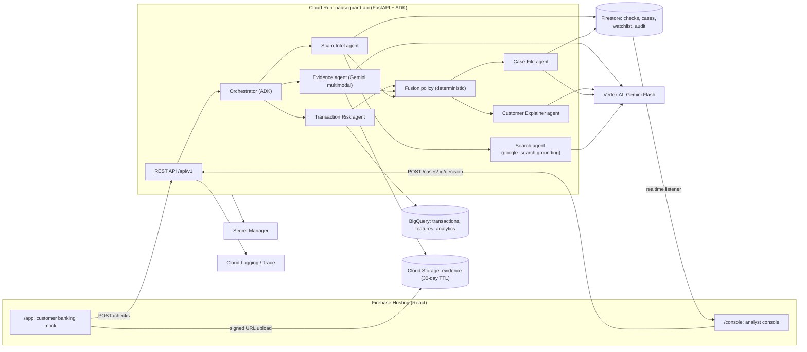

# Architecture: PauseGuard

## 1. System diagram



Keep a rendered PNG of this at `docs/img/architecture.png` for the deck (phase 11).

## 2. Request flow (happy path)

1. Customer fills in a transfer → `POST /api/v1/checks` with the transfer details.
2. API creates `checks/{check_id}` in Firestore (status `SCORING`) and calls the **Transaction Risk** tool (BigQuery or SQLite). This takes under 300 ms and needs no LLM.
3. If `txn_score < 30` and there's no watchlist hit on the payee → verdict GREEN immediately, no check-in.
4. Otherwise → status `CHECKIN`, and the response includes the first check-in question (from a template, not generated, so it's instant).
5. Customer replies `POST /api/v1/checks/{id}/messages` with text and optional `evidence_uris` (uploaded first via `POST /api/v1/uploads/sign`).
6. Orchestrator runs **in parallel**: Evidence agent (image/PDF/text/audio) and the watchlist lookups (payee account and the entities in the customer's text), then a watchlist pass on the entities the evidence agent found. The transaction features are already computed.
7. **Fusion policy** (pure Python) → verdict, recommended action and reasons.
8. **Explainer agent** writes the customer message in the customer's language and the customer gets their answer. For AMBER/RED, a `cases/{case_id}` document is created at once; then the **Case-File agent** writes the analyst summary while the **Scam-Intel agent** checks unknown websites and platforms with Google Search (web findings never change the verdict, so they stay off the customer's critical path).
9. API returns the verdict. The progress events were streamed via SSE `GET /api/v1/checks/{id}/events` (the MVP can poll instead).
10. The console's Firestore listener shows the new case instantly. The analyst decides → `POST /api/v1/cases/{id}/decision` → audit log + watchlist update.

Optionally, the check-in can ask one follow-up question if the evidence is missing and txn_score ≥ 70 (max 2 turns in total; keep it short).

## 3. Why these services (for the "Technologies" slide)

| Need | Choice | Why |
|---|---|---|
| Agent framework | **ADK** | Organiser-recommended; multi-agent orchestration, tools, evaluation, tracing |
| LLM | **Gemini Flash on Vertex AI** | Multimodal (images, PDF, audio), fast, cheap, supports bounding boxes and structured JSON output |
| Grounding | **Google Search grounding** (ADK `google_search`) | Checks unknown "investment platforms" and domains against the live web |
| Serving | **Cloud Run** | Serverless, scales to zero, container-based, Singapore region |
| Transactional data and analytics | **BigQuery** | Feature SQL over the transaction history; analytics for the dashboard; optional BigQuery ML anomaly model |
| App state and realtime | **Firestore** | Realtime listeners make the console "live" with no extra infrastructure |
| Files | **Cloud Storage** | Signed-URL uploads; lifecycle rule deletes files after 30 days |
| Frontend hosting and auth | **Firebase Hosting + Auth** | One-command deploy; anonymous auth for customers, email/password for analysts |
| Local dev | **SQLite + Firestore emulator** | Organiser-recommended path for local work; the same repository interface is used in cloud |

## 4. Key design decisions

- **D1: LLMs extract, rules decide.** The fusion policy is deterministic and unit-tested. This gives explainability for regulators and judges, and stops the LLM from approving a payment on its own.
- **D2: Templated first question, generated explanation.** The first check-in question is instant and consistent; Gemini is used where it adds value.
- **D3: Parallel analysis.** Evidence and the watchlist lookups run concurrently (`asyncio` tasks over agent runs); web search and the case file run after the verdict, in parallel. Target p50 under 5 s (PRD), ≤ 6 s for phase 04.
- **D4: Search grounding in its own sub-agent.** ADK's built-in `google_search` tool may not combine with other tools in one agent, so it gets a dedicated `search_agent`, which the Scam-Intel agent calls through `AgentTool`. Check the current ADK docs.
- **D5: One web app, two areas.** `/app` (mobile frame, customer) and `/console` (desktop, analyst). This makes one deploy and one design system.
- **D6: Repository pattern.** `TransactionRepo` has SQLite and BigQuery implementations, chosen by `DATA_BACKEND`.
- **D7: Safe failure.** Timeouts (agent budget of 12 s in total) or schema failures → AMBER + `needs_review=true`.

Record any new decision in `docs/DECISIONS.md` (create the file if it's missing).

## 5. Environment variables (`.env.example`)

```
PRODUCT_NAME=PauseGuard
GOOGLE_CLOUD_PROJECT=your-project-id
GOOGLE_CLOUD_LOCATION=global            # Vertex AI location for Gemini
GOOGLE_GENAI_USE_VERTEXAI=TRUE
GEMINI_MODEL=gemini-3.8-flash           # GA Flash verified 10 Oct 2026 (2.5 Flash retires 16 Oct 2026); see DECISIONS.md
DATA_REGION=asia-southeast1
DATA_BACKEND=sqlite                     # sqlite | bigquery
SQLITE_PATH=./data/seed/pauseguard.db
BQ_DATASET=pauseguard
STATE_BACKEND=firestore                 # firestore | memory (tests; dev without the emulator)
FIRESTORE_EMULATOR_HOST=localhost:8080  # local only
EVIDENCE_BUCKET=your-project-pauseguard-evidence
ALLOWED_ORIGINS=http://localhost:5173
AGENT_TIMEOUT_SECONDS=12
LOG_LEVEL=INFO
# web (Vite)
VITE_API_BASE_URL=http://localhost:8000
VITE_FIREBASE_CONFIG_JSON={...}
```

## 6. Scaling and production notes (for the "Future development" slide)

- Deploy per bank as a private service. The bank calls `/checks` from its payment orchestration, with mTLS.
- Swap synthetic transactions for the bank's feature store. Plug the watchlist into national feeds (for example, the anti-scam centre's lists) and telco scam-call signals.
- Vertex AI Agent Engine for managed agent hosting and session memory. A/B testing of explanations to reduce click-through.
- Model monitoring: weekly re-run of the eval set, plus drift on typology distribution.
