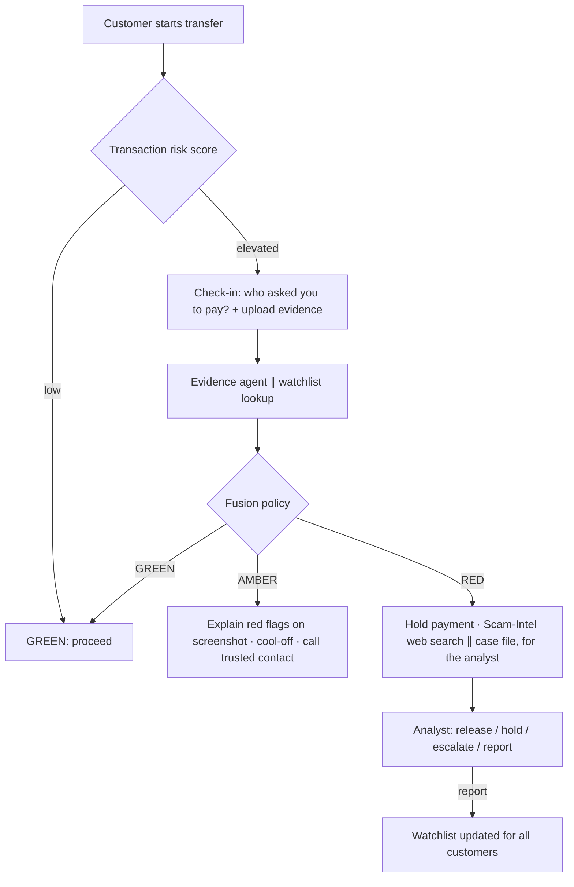

# Submission Deck Content (maps 1:1 to the official template)

Fill the official template (`reference/Submission_Template_AI_Builder_Cup.pptx`) with this content in phase 11. Keep each slide short: about 5 bullets or one diagram. Replace every `[X]` with real numbers from `eval/reports/benchmark.md`.

## 1. Team details
- Team name: `[team name]`
- Team leader: `[name]`
- **Problem statement:** Authorised-push-payment scams. In 82% of Singapore scam cases the victim sends the money themselves (S$913M lost in 2025). Bank fraud systems score the transaction but never see the conversation that persuaded the customer, so they miss these payments.

## 2. Brief about the idea
PauseGuard is an AI copilot inside the bank's payment flow. When a transfer looks risky, it asks the customer one quick question and lets them share the chat, call or screenshot behind the payment. Gemini agents built with ADK analyse that evidence, check scam intelligence and the live web, and a transparent policy decides whether to proceed, pause and explain, or hold for a human analyst. Customers see exactly why, highlighted on their own screenshot, in their own language.

## 3. Opportunities
- **How it's different:** existing tools look only at the transaction (or show generic warnings). PauseGuard analyses the *social-engineering evidence* at the moment of payment, with multimodal Gemini.
- **How it solves the problem:** it catches persuaded payments that transaction models can't see, explains the risk in a way that breaks the scammer's spell, and gives analysts ready-made case files.
- **USP:** "Fraud models check the transaction; PauseGuard checks the conversation." Explainable, bilingual, human-in-the-loop, and one API call to integrate.

## 4. Features
Smart risk trigger · conversational check-in (text, quick replies; voice is stretch) · evidence upload (image, PDF, text) · red flags drawn on the screenshot · multilingual explanations (EN/中文) · cool-off and trusted-contact actions · realtime analyst console · one-click decisions with audit trail · self-learning watchlist · fraud dashboard (money protected, FPR, latency) · public benchmark.
*(Edit this list to match exactly what was built.)*

## 5. Process flow / use-case diagram
`docs/img/process-flow.png`, generated from this Mermaid:

## 6. Wireframes / mocks
Screens from `docs/img/screens/`: check-in sheet, AMBER evidence card, RED screen, console case view, dashboard.

## 7. Architecture diagram
`docs/img/architecture.png` (from `ARCHITECTURE.md` §1).

## 8. Technologies
Gemini Flash on Vertex AI (multimodal, structured output, bounding boxes) · Agent Development Kit (multi-agent orchestration, tools, eval) · Google Search grounding · Cloud Run · Firebase Hosting & Auth · Firestore (realtime) · BigQuery (features + analytics) · Cloud Storage (lifecycle) · Secret Manager · Cloud Logging/Trace · Python/FastAPI · React/TypeScript/Tailwind · SQLite for local dev.

## 9. Estimated implementation cost
From `docs/COSTS.md`: prototype about US$[X]/month; pilot at 50k checks/month about US$[X]/month, i.e. about US$[X] per check. Compare with the average loss per scam case (median S$1,644 in 2025, from the SPF): stopping a single scam pays for about [X] checks.

## 10. Snapshots of the prototype
4–6 real screenshots from the deployed app, with captions.

## 11. Performance report / benchmarking
On the 100-case held-out test set (synthetic, labelled; model `[id]`, date `[date]`):
| System | Scam recall | FPR (legit→stopped) | Legit→RED | Typology acc. | p50 latency | Cost/check |
|---|---|---|---|---|---|---|
| Rules only | [X]% | [X]% | [X]% | n/a | [X] ms | $0 |
| Gemini single prompt | [X]% | [X]% | [X]% | [X]% | [X] s | $[X] |
| **PauseGuard** | **[X]%** | **[X]%** | **[X]%** | **[X]%** | **[X] s** | **$[X]** |
Plus the chart and the explanation clarity score [X]/5. Limitations: synthetic data and our own labels.

## 12. Additional details / future development
Bank pilot with real (consented) data · telco scam-call signals and national anti-scam feeds · voice check-ins and more languages (Malay, Tamil, Bahasa Indonesia, Thai, Vietnamese) · Vertex AI Agent Engine with session memory · a "trusted contact" co-approval flow for seniors · alignment with Singapore's Shared Responsibility Framework and MAS guidance · an expansion path across JAPAC.

## 13. Links
- GitHub (public): `[url]`
- Demo video (3–4 min): `[url]`
- Live product: `[url]` (customer app + analyst console demo login: `[email/password]`)

## Likely judge questions
Kept in the git-ignored `private/judge-questions.md` (pitch prep, not for the public repo).
