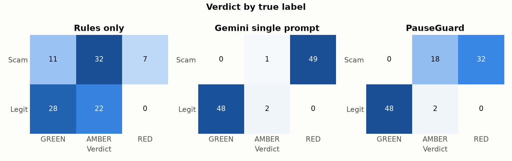
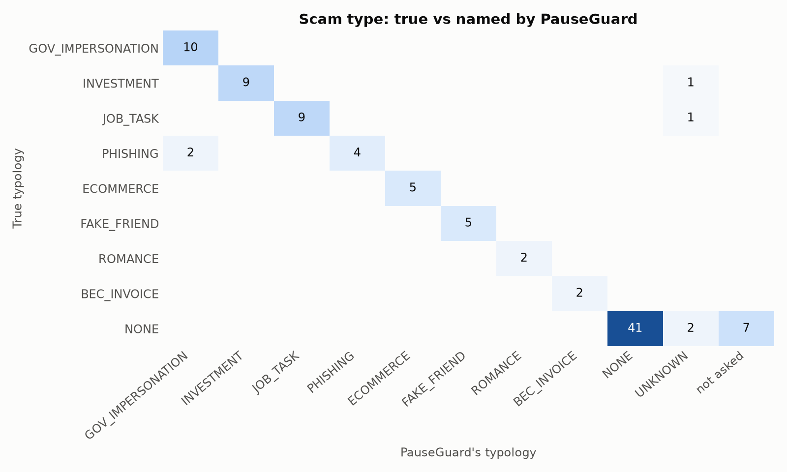
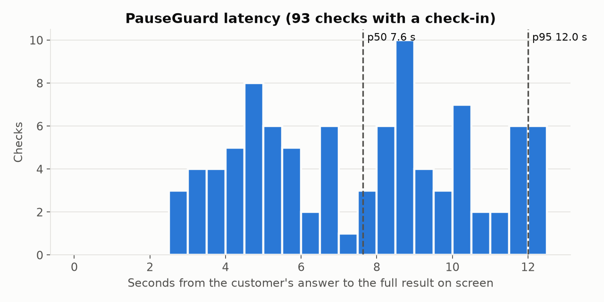

# Benchmark: rules vs a single Gemini prompt vs PauseGuard

<!-- Generated by eval/report.py from eval/results/; edit the code, not this file. -->

**Run `20261016T1447Z_api_test`** · model `gemini-3.8-flash` (thinking LOW, media MEDIUM) · git `bc9a38427790-dirty` · the deployed API (https://pauseguard-api-b26gd5iupa-as.a.run.app, Cloud Run asia-southeast1). Transaction scores: the deployed BigQuery data, scored at request time. Customer-facing budget 12 s. Report generated 2026-10-16 14:59 UTC.

Test split only: 100 cases (50 scams, 50 legitimate hard negatives), frozen before any of these systems ran on it (`eval/TEST_SPLIT_HASH`, `make eval-verify`). Nothing was tuned on it.

## Headline

> On 100 held-out synthetic cases (50 scams, 50 legitimate), rules alone stopped 78% of scams; a single Gemini prompt with no time limit stopped 100% (and 4% of legitimate payments), but 12 of its 100 answers took longer than PauseGuard's 12 s budget; PauseGuard stopped 100% with a 4% false-positive rate (0% of legitimate payments held as RED), answering in 7.6 s median after the customer's reply, at $0.0070 per check.

## Results

SCAM is the positive class; *stopped* means AMBER or RED. Rates show the Wilson 95% interval in brackets: with 50 + 50 cases, a few points either way is noise.

| System | Scam recall | Hard stop (RED) | FPR (legit stopped) | Legit → AMBER | Legit → RED | Precision | F1 | Typology acc. | p50 / p95 end to end | p50 / p95 answer → result | Cost / check |
|---|---|---|---|---|---|---|---|---|---|---|---|
| Rules only (B0) | 78% (65–87) | 14% (7–26) | 44% (31–58) | 44% | 0% (0–7) | 64% | 0.70 | n/a | 929 ms / 1.5 s | n/a | $0 |
| Gemini single prompt (B1) | 100% (93–100) | 98% (90–100) | 4% (1–13) | 4% | 0% (0–7) | 96% | 0.98 | 96% | 6.4 s / 18.4 s | 5.4 s / 17.6 s | $0.0012 |
| **PauseGuard** | **100% (93–100)** | 64% (50–76) | **4% (1–13)** | 4% | 0% (0–7) | 96% | 0.98 | 92% | 8.2 s / 13.0 s | 7.6 s / 12.0 s | $0.0070 |

- **End to end** = transaction risk + (for systems that read the conversation) the model work after the customer's answer. **Answer → result** = from the customer's answer to the full message on screen (PauseGuard: checks with a check-in; the PRD target is p50 ≤ 5 s, p95 ≤ 10 s).
- PauseGuard asked 93 of 100 customers the check-in question; 7 transfers took the GREEN fast path (a low score with no check-in; 0 of them scams). 4 checks fell back to AMBER + human review (a model error or the time budget), which counts as stopped.
- The fallbacks: 2 scams (ev_0029, ev_0070) and 2 legitimate payments (ev_0108, ev_0146), AMBER because the analysis did not finish in time, not because it found anything. Counting only the checks whose analysis finished: recall 48/48, FPR 0/48.
- B1 gets the same inputs (built by the evidence agent's own code), the transaction score and reasons, no time budget and one retry; see `eval/baselines/single_prompt.py`.
- Held to PauseGuard's 12 s budget (a later answer becomes AMBER + review, as in the product), B1 would answer 12 of 100 cases late and score recall 100%, FPR 16%, legit → RED 0%.

For the deck (SUBMISSION_DECK slide 11):

| System | Scam recall | FPR (legit→stopped) | Legit→RED | Typology acc. | p50 latency | Cost/check |
|---|---|---|---|---|---|---|
| Rules only (B0) | 78% | 44% | 0% | n/a | 929 ms | $0 |
| Gemini single prompt (B1) | 100% | 4% | 0% | 96% | 5.4 s | $0.0012 |
| PauseGuard | 100% | 4% | 0% | 92% | 7.6 s | $0.0070 |




## Ablations: where the misses come from

Local run `20261015T0334Z_local_test`. *Always ask* turns the GREEN fast path off, so every transfer gets the check-in; *answer only* drops the screenshot, PDF or pasted chat and keeps the customer's typed answer. In both, the case file and the web search (which run after the verdict and never change it) are skipped.

| System | Scam recall | Hard stop (RED) | FPR | Legit → RED | Typology acc. | Scams never asked (fast path) | Needs review (failures) |
|---|---|---|---|---|---|---|---|
| PauseGuard | 100% (93–100) | 66% | 2% (0–10) | 0% | 94% | 0 | 2 |
| PauseGuard, always ask (no fast path) | 100% (93–100) | 58% | 6% (2–16) | 0% | 82% | 0 | 10 |
| PauseGuard, answer only (no evidence) | 92% (81–97) | 48% | 2% (0–10) | 0% | 88% | 0 | 1 |

*PauseGuard, always ask (no fast path)* ran into a slow endpoint: 10 of 100 checks hit the time budget (AMBER + review), 3 of them legitimate payments, so its FPR and typology accuracy are worse than its analysis. Read it as indicative.

## Fairness breakdowns

Recall (scams stopped / scams) and FPR (legit stopped / legit) per group. Small groups: read them as a check for large gaps, not as precise rates.

| Language | Scams / legit | Rules only (B0) recall / FPR | Gemini single prompt (B1) recall / FPR | PauseGuard recall / FPR |
|---|---|---|---|---|
| en | 32 / 31 | 24/32 / 14/31 | 32/32 / 2/31 | 32/32 / 1/31 |
| zh | 18 / 19 | 15/18 / 8/19 | 18/18 / 0/19 | 18/18 / 1/19 |

| Evidence | Scams / legit | Rules only (B0) recall / FPR | Gemini single prompt (B1) recall / FPR | PauseGuard recall / FPR |
|---|---|---|---|---|
| image | 32 / 30 | 26/32 / 12/30 | 32/32 / 1/30 | 32/32 / 2/30 |
| pdf | 5 / 3 | 4/5 / 3/3 | 5/5 / 0/3 | 5/5 / 0/3 |
| text | 12 / 15 | 8/12 / 6/15 | 12/12 / 1/15 | 12/12 / 0/15 |
| none | 1 / 2 | 1/1 / 1/2 | 1/1 / 0/2 | 1/1 / 0/2 |

| Customer age | Scams / legit | Rules only (B0) recall / FPR | Gemini single prompt (B1) recall / FPR | PauseGuard recall / FPR |
|---|---|---|---|---|
| under 40 | 19 / 17 | 12/19 / 7/17 | 19/19 / 1/17 | 19/19 / 0/17 |
| 40-59 | 25 / 24 | 23/25 / 13/24 | 25/25 / 1/24 | 25/25 / 2/24 |
| 60+ | 6 / 9 | 4/6 / 2/9 | 6/6 / 0/9 | 6/6 / 0/9 |

| Difficulty | Scams / legit | Rules only (B0) recall / FPR | Gemini single prompt (B1) recall / FPR | PauseGuard recall / FPR |
|---|---|---|---|---|
| obvious | 23 / 27 | 19/23 / 11/27 | 23/23 / 2/27 | 23/23 / 1/27 |
| subtle | 27 / 23 | 20/27 / 11/23 | 27/27 / 0/23 | 27/27 / 1/23 |

## By scam type

| Scam type | n | Rules only (B0) stopped | Gemini single prompt (B1) stopped | PauseGuard stopped | PauseGuard named it |
|---|---|---|---|---|---|
| GOV_OFFICIAL_IMPERSONATION | 10 | 10/10 | 10/10 | 10/10 | 10/10 |
| INVESTMENT | 10 | 10/10 | 10/10 | 10/10 | 9/10 |
| JOB_TASK | 10 | 8/10 | 10/10 | 10/10 | 9/10 |
| PHISHING | 6 | 0/6 | 6/6 | 6/6 | 4/6 |
| ECOMMERCE | 5 | 2/5 | 5/5 | 5/5 | 5/5 |
| FAKE_FRIEND | 5 | 5/5 | 5/5 | 5/5 | 5/5 |
| ROMANCE | 2 | 2/2 | 2/2 | 2/2 | 2/2 |
| BEC_INVOICE | 2 | 2/2 | 2/2 | 2/2 | 2/2 |

Typology accuracy on the scams PauseGuard analysed (excluding the fast path): 92% (46/50).



## Latency

Answer → full customer result: p50 7.6 s, p95 12.0 s against the PRD's 5 s / 10 s: **not met** on this run. The p95 sits at the 12 s budget, where a slow check falls back to AMBER + review.

PauseGuard, per step (checks with a check-in):

| Step | n | p50 | p95 |
|---|---|---|---|
| Transaction risk (at POST /checks) | 93 | 881 ms | 1.5 s |
| Evidence agent (Gemini, multimodal) | 89 | 5.6 s | 9.3 s |
| Watchlist lookups (+ web search, after the verdict) | 93 | 5.3 s | 25.0 s |
| Answer → verdict known | 93 | 5.9 s | 9.9 s |
| Explainer (Gemini, AMBER/RED only) | 48 | 2.4 s | 4.0 s |
| **Answer → full customer result** | 93 | 7.6 s | 12.0 s |
| Case file (Gemini, after the verdict, analyst only) | 52 | 4.8 s | 9.1 s |



## Cost

Prices: `gemini-3.8-flash`, Vertex AI Standard tier, global endpoint: US$0.75 per 1M input tokens and US$3.75 per 1M output tokens (thinking included), introductory until 2026-12-31; list price from 2027 US$1.5 / US$7.5. Source: https://cloud.google.com/vertex-ai/generative-ai/pricing (retrieved 2026-10-15). Cost per check is the mean over **all** cases, so GREEN fast-path checks (no model call) count as $0.

| System | Tokens in / out per check | Cost per check | Per 1,000 checks | At the 2027 list price |
|---|---|---|---|---|
| Rules only (B0) | 0 / 0 | $0 | $0.00 | $0 |
| Gemini single prompt (B1) | 1,206 / 81 | $0.0012 | $1.21 | $0.0024 |
| PauseGuard | 5,216 / 831 | $0.0070 | $7.03 | $0.014 |

## Local vs deployed

The same test split through the in-process orchestrator and through the deployed API. The deployed run scores transactions on the BigQuery copy at request time, so a few scores (and so B0) can differ from the pinned local run.

| Run | Where the agents ran | Recall | FPR | Legit → RED | Typology | p50 / p95 answer → result | Needs review |
|---|---|---|---|---|---|---|---|
| `20261015T0334Z_local_test` | this laptop → Vertex AI global | 100% | 2% | 0% | 94% | 5.8 s / 12.0 s | 2 |
| `20261016T1447Z_api_test` | Cloud Run asia-southeast1 | 100% | 4% | 0% | 92% | 7.6 s / 12.0 s | 4 |

## Misses and false alarms (PauseGuard)

**Scams PauseGuard let through (0).**

None.

**Legitimate payments PauseGuard stopped (2).**

| Case | Kind | Lang | Evidence | Verdict | Read as | Why |
|---|---|---|---|---|---|---|
| ev_0108 | FRIEND_NEW_NUMBER | en | image | AMBER (needs review) | – (n/a) | Automatic analysis did not finish; a person needs to review |
| ev_0146 | BROKER_TOPUP | zh | image | AMBER (needs review) | – (n/a) | Automatic analysis did not finish; a person needs to review |

## Explanation clarity (human rating)

Not collected yet. `eval/human_rating_form.md` has 20 AMBER/RED explanations from this run for 3–5 raters (at least one aged 60+) to score 1–5; save the answers as `eval/human_ratings.csv` (`rater,rater_age_band,item,clarity,comment`) and run `make eval-report`.

## Runs

Every benchmark run on this split. A run is reportable when the Gemini endpoint passed the pre-flight check (5 one-word replies: median ≤ 3 s, at most one above 10 s) and at most 5% of PauseGuard's check-ins fell back to AMBER + review; a run above that measured a degraded endpoint and is discarded, not hidden.

| Run | Target | Git | Pre-flight pings | PauseGuard timeouts (AMBER + review) | Status |
|---|---|---|---|---|---|
| `20261015T0334Z_local_test` | local | `d0d55fa7fa8d` | 24.0, 1.6, 2.1, 1.0, 1.5 s | 2/94 | kept, not the primary run |
| `20261016T1447Z_api_test` | api | `bc9a38427790-dirty` | 1.8, 1.2, 1.2, 0.8, 1.1 s | 4/93 | **reported** |

## Limitations

- **Synthetic data and our own labels.** The cases were drafted from public scam advisories, rewritten with fictional people, banks and numbers, and reviewed by us; real scam messages are messier and adapt. No real bank traffic was used.
- **Small sample.** 50 scams and 50 legitimate payments; the brackets show how wide the uncertainty is. Subgroups (age, evidence type) are smaller still.
- **The mix is not the real base rate.** Half the cases are scams, while almost all real payments are legitimate, so precision here is far higher than it would be in production. The false-positive rate is the number to watch.
- **No watchlist hits.** Eval entities are kept off the seed watchlist on purpose, so the watchlist's hard stops (which would help both B0 and PauseGuard) are not measured.
- **Latency depends on where it runs** (see the run line at the top); Gemini latency on the global endpoint varies by time of day.

## Reproduce

```bash
make eval-verify                    # the test split is unchanged
make eval                           # local run (all systems) + this report
make eval API=deployed              # PauseGuard, B0, B1 through the live Cloud Run API
make eval-report                    # rebuild this report from eval/results/
```

Raw rows (one per case and system, with the model, git SHA and timings): `eval/results/20261016T1447Z_api_test_b0.jsonl`, `eval/results/20261016T1447Z_api_test_b1.jsonl`, `eval/results/20261016T1447Z_api_test_pauseguard.jsonl`.
